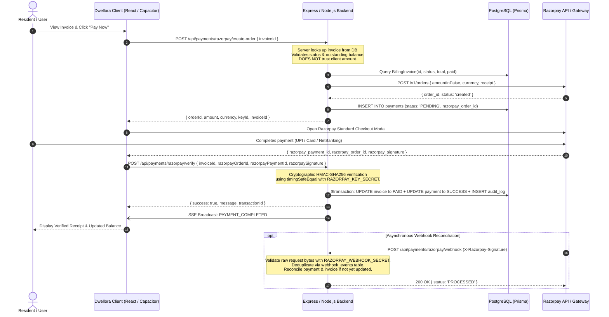

# Dwellora — Razorpay Payment Integration Plan

## 1. Executive Summary & Architecture Overview
This plan specifies the production-quality, end-to-end integration of the **Razorpay Payment Gateway** into the **Dwellora** society management platform.
The integration covers the entire transaction lifecycle: server-side order creation from authorized database invoices, Razorpay Standard Checkout in web and Capacitor Android, cryptographic signature verification with constant-time comparison, atomic database transactions in PostgreSQL via Prisma, idempotent webhook processing with raw body preservation, audit logging, and real-time SSE broadcasts.



---

## 2. Security Architecture & Environment Secrets

### Server-Side Secrets
The following secrets are strictly maintained on the server-side and never exposed to Vite client bundles, Capacitor Android native assets, logs, or Git:
- `RAZORPAY_KEY_ID`: Razorpay public API key identifier (used by server and sent to client only as needed for checkout initialization).
- `RAZORPAY_KEY_SECRET`: Razorpay API private secret (used exclusively on the backend for API authentication and HMAC-SHA256 signature verification).
- `RAZORPAY_WEBHOOK_SECRET`: Razorpay Webhook private signing secret (used exclusively on the backend for webhook signature validation).

### Client Security Principles
- **Zero Client Trust on Financials**: The frontend never supplies or influences the payable amount, currency, invoice owner, or society ID. All parameters are derived directly from PostgreSQL database records.
- **Constant-Time Cryptographic Comparison**: Signature checks utilize `crypto.timingSafeEqual` with fixed-size UTF-8 buffers to prevent side-channel timing attacks.
- **Android WebView Safety**: No API secrets or private keys are bundled into Android assets or capacitor configs. The checkout relies on Razorpay Checkout JS loaded dynamically or via verified WebView callbacks.

---

## 3. Database Schema Updates (PostgreSQL / Prisma)

### Existing Models Inspected
1. `BillingInvoice`:
   - Contains `id`, `societyId`, `invoiceNumber`, `totalAmount`, `paidAmount`, `status` (`PENDING`, `PAID`, `PARTIALLY_PAID`, `OVERDUE`, `CANCELLED`), `paymentMode`, `paidAt`.
2. `Payment`:
   - Contains `id`, `societyId`, `invoiceId`, `residentId`, `userId`, `amount`, `currency`, `status` (`PENDING`, `SUCCESS`, `FAILED`, `REFUNDED`), `razorpayOrderId`, `razorpayPaymentId`, `razorpaySignatureVerified`, `paymentMethod`, `failureReason`, `refundId`, `refundAmount`, `refundReason`, `refundedAt`, `metadata`.

### Required Schema Additions
1. **Uniqueness & Indexing in `Payment`**:
   - Add `@unique` to `razorpayOrderId` and `razorpayPaymentId` (allowing multiple nulls, unique non-null values) to enforce database-level duplicate payment prevention.
   - Add index on `status` and `createdAt` for fast reconciliation queries.
2. **New Model `WebhookEvent`**:
   - To guarantee **idempotency and deduplication** of Razorpay webhook deliveries:
   ```prisma
   model WebhookEvent {
     id          String   @id @default(uuid())
     eventId     String   @unique @map("event_id")
     eventType   String   @map("event_type")
     payload     Json
     status      String   @default("PROCESSED") // PROCESSED, FAILED, IGNORED
     createdAt   DateTime @default(now()) @map("created_at")

     @@map("webhook_events")
   }
   ```

---

## 4. Backend Endpoints Specification

### 1. `POST /api/payments/razorpay/create-order`
- **Authentication**: JWT token required (`req.userId`, `req.societyId`, `req.userRole`).
- **Input**: `{ invoiceId: string, currency?: string }`.
- **Validation**:
  - Retrieve `BillingInvoice` by `invoiceId`.
  - Validate that `invoice.status` is `PENDING` or `OVERDUE` (reject `PAID` or `CANCELLED`).
  - Verify authorization: requester must be invoice resident, society admin, or secretary.
  - Calculate `balanceAmount = totalAmount - paidAmount`. Must be `> 0`.
  - Convert to integer subunits: `amountInPaise = Math.round(balanceAmount * 100)`.
- **Razorpay Order Creation**:
  - Call Razorpay Orders API (`POST https://api.razorpay.com/v1/orders`) or test fallback generator when configured with test keys.
  - Persist `Payment` record with status `PENDING` and `razorpayOrderId`.
- **Response**: `{ orderId, amount, currency, keyId, invoiceId, notes }`.

### 2. `POST /api/payments/razorpay/verify`
- **Authentication**: Authenticated user.
- **Input**: `{ invoiceId: string, razorpayPaymentId: string, razorpayOrderId: string, razorpaySignature: string }`.
- **Verification Logic**:
  - Compute HMAC-SHA256: `hash = hmac_sha256(orderId + "|" + paymentId, RAZORPAY_KEY_SECRET)`.
  - Validate with constant-time `crypto.timingSafeEqual(Buffer.from(hash), Buffer.from(signature))`.
  - Verify invoice is still pending and payment belongs to invoice.
- **Atomic Database Transaction (`prisma.$transaction`)**:
  - Update `BillingInvoice`: set `status = 'PAID'`, `paidAmount = totalAmount`, `paidAt = new Date()`, `paymentMode = 'RAZORPAY'`.
  - Update `Payment`: set `status = 'SUCCESS'`, `razorpayPaymentId`, `razorpaySignatureVerified = true`, metadata with transaction details.
  - Insert `AuditLog`: record actor, timestamp, payment ID, order ID, and amount.
- **Notification**: Broadcast SSE `PAYMENT_COMPLETED` event.
- **Response**: `{ success: true, message, invoice, transactionId }`.

### 3. `POST /api/payments/razorpay/webhook`
- **Public HTTPS Endpoint**: No session cookie/JWT required, authenticated exclusively via signature.
- **Raw Request Body**: Express `verify` callback preserves exact raw byte buffer `req.rawBody`.
- **Signature Validation**:
  - Compute `expected = hmac_sha256(rawBody, RAZORPAY_WEBHOOK_SECRET)`.
  - Compare with header `X-Razorpay-Signature` via constant-time comparison.
- **Deduplication**:
  - Check `WebhookEvent` table for existing `event.id` or `payment.id`.
  - If already processed, acknowledge with `200 OK` without reapplying side-effects.
- **Event Handling**:
  - `payment.captured`: Reconcile invoice to `PAID` if not already paid, update payment record to `SUCCESS`.
  - `payment.failed`: Update payment record to `FAILED` with `failureReason`.
  - `refund.processed`: Update payment record to `REFUNDED` with refund amount and timestamp.
- **Response**: `200 OK { status: 'PROCESSED' }`.

### 4. `POST /api/payments/razorpay/refund`
- **Authentication**: Strict role check: `admin` or `secretary` only.
- **Input**: `{ paymentId: string, amount: number, reason: string }`.
- **Logic**:
  - Execute refund via Razorpay API if live keys are present.
  - Update PostgreSQL `Payment` record with `status = 'REFUNDED'`, `refundAmount`, `refundReason`, `refundedAt`.
  - Record `AuditLog` entry and broadcast `PAYMENT_REFUNDED`.

### 5. `GET /api/payments/status/:orderId` & `GET /api/payments`
- Query server-authoritative payment history and status filtered by society, user, or invoice.

---

## 5. Frontend & Mobile Checkout Flow
1. **Resident Billing Dashboard (`ResidentBillingPage.tsx`)**:
   - Invoices display real-time status (`PENDING`, `OVERDUE`, `PAID`).
   - "Pay Now" initiates `RazorpayCheckoutModal`.
2. **Razorpay Standard Checkout (`RazorpayCheckout.tsx`)**:
   - Dynamically injects official `checkout.js`.
   - Passes only public `keyId`, `order_id`, integer amount in paise, prefill user details, and society name.
   - Branding logo is used only when a valid public HTTPS URL is configured.
   - Handles dismiss / cancellation cleanly without leaving dangling corrupt states.
   - On completion, sends verification payload including `razorpaySignature` to `/api/payments/razorpay/verify`.
   - On success, switches to `ReceiptModal` displaying download/print options, transaction reference, timestamp, and cleared balance.
3. **Capacitor Android Support**:
   - The standard Checkout popup runs in standard Android WebViews without native binary dependencies or exposed secrets.
   - All network calls flow over HTTPS to the secure Express backend.

---

## 6. Automated Testing Strategy
Add tests in `tests/razorpay.test.ts` using Jest:
1. **Order Creation Security**: Reject missing invoice; reject already-paid invoice; reject unauthorized society invoice; ensure client-supplied amount is ignored.
2. **Signature Verification**: Valid signature passes; tampered signature rejected with 403; constant-time comparison validation.
3. **Webhook Verification**: Valid raw body signature passes; corrupted raw body rejected; duplicate event deduplication works idempotently.
4. **Duplicate Verification Prevention**: Second call on already-verified payment returns safe idempotent response without duplicate ledger entries.
5. **Refund Authorization**: Non-admin rejected; admin refund updates database and audit log.
